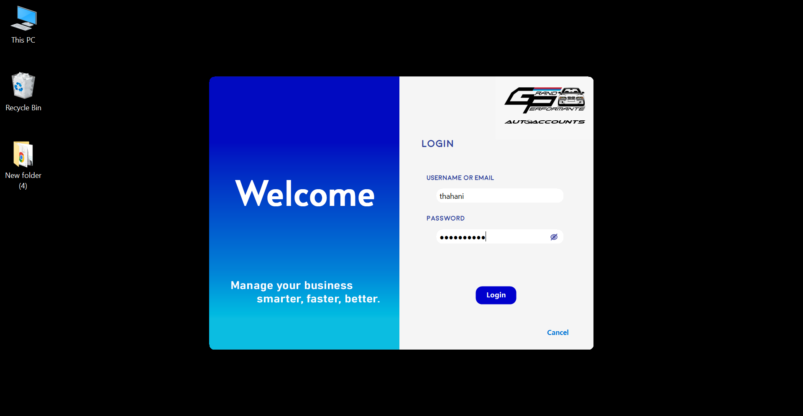
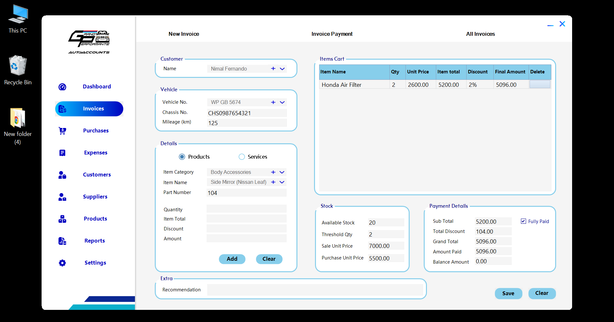

# GP AutoAccounts | Accounting & Inventory System

GP AutoAccounts is a tailored C# Windows Forms solution designed to automate end-to-end financial and inventory management for GP Automotive Workshop. By analyzing their daily workflows, this system replaces manual tracking with a digital ecosystem powered by SQL Server.

## Tech Stack

- **Language & Framework:** C# (Windows Forms)
- **Database:** SQL Server
- **IDE:** Visual Studio

## Core Features

- **Digital Dashboard:** Tracks real-time sales, expenses, and overall account balances.
- **Automated Financials:** Streamlines invoice generation and financial reporting.
- **Dynamic Client Tracking:** Features dynamic customer balance tracking to easily manage pending payments and credit.
- **Relational Database Modules:** Uses a normalized SQL Server architecture to securely manage workshop inventory and financial transactions.

## Screenshots

**Login Screen**


**Invoice Generation Screen**


## Getting Started

Follow these instructions to set up and run the project locally on your machine.

### Prerequisites

- Visual Studio (with .NET desktop development workload installed)
- SQL Server (Express, Developer, or Standard edition)

### Installation & Setup

1. **Clone the repository:**
   ```bash
   git clone [https://github.com/AsfaThahani/GPAutoAccounts.git](https://github.com/AsfaThahani/GPAutoAccounts.git)
